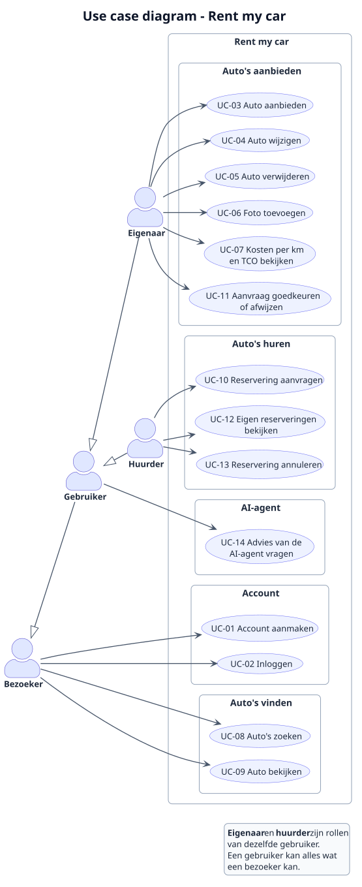

# 1. Analyse

In dit hoofdstuk staat wat de applicatie moet kunnen. De eisen komen uit de casus Rent my car en uit de minimale eisen van de opdracht. Waar de casus niets zegt, heb ik zelf een keuze gemaakt; die keuzes staan erbij.

## 1.1 Functionele eisen

| Nr | Eis |
|---|---|
| FE-01 | Een bezoeker kan een account aanmaken. |
| FE-02 | Een gebruiker kan inloggen met e-mailadres en wachtwoord. |
| FE-03 | Een gebruiker kan een auto aanbieden met gegevens, adres en tarieven. |
| FE-04 | Er zijn drie soorten auto's: ICE (brandstof), BEV (elektrisch met accu) en FCEV (waterstof). Ze hebben gedeelde gegevens en gedeelde functionaliteit. |
| FE-05 | De eigenaar kan zijn auto wijzigen. |
| FE-06 | De eigenaar kan zijn auto verwijderen, zolang er geen aangevraagde of goedgekeurde reserveringen in de toekomst zijn. |
| FE-07 | De eigenaar kan foto's toevoegen aan zijn auto en weer verwijderen. |
| FE-08 | De eigenaar kan de kosten per kilometer van zijn auto laten berekenen. De berekening verschilt per soort auto. |
| FE-09 | De eigenaar kan de TCO (totale kosten per jaar) van zijn auto laten berekenen, uitgaande van 15.000 km per jaar. |
| FE-10 | Iedereen kan een lijst met auto's bekijken en zoeken en filteren op soort auto, plaats, maximale uurprijs en beschikbaarheid in een periode. |
| FE-11 | Iedereen kan de details van een auto bekijken, inclusief foto's. |
| FE-12 | Een gebruiker kan een reservering aanvragen voor een auto van een ander, met een start- en eindmoment en het verwachte aantal kilometers. |
| FE-13 | Bij een aanvraag ziet de huurder de geschatte huurprijs: uurtarief × aantal uren + km-tarief × verwachte kilometers. |
| FE-14 | De eigenaar kan een aanvraag goedkeuren of afwijzen. |
| FE-15 | Een aanvraag kan alleen worden goedgekeurd als de auto in die periode niet al is verhuurd (geen overlap met een andere goedgekeurde reservering). |
| FE-16 | De huurder kan een reservering annuleren zolang de huurperiode nog niet is begonnen. |
| FE-17 | Een gebruiker kan zijn eigen reserveringen bekijken. |
| FE-18 | De eigenaar kan de aanvragen en reserveringen voor zijn auto's bekijken. |
| FE-19 | Na goedkeuring ziet de huurder de contactgegevens van de eigenaar, zodat zij de sleuteloverdracht kunnen afspreken. |
| FE-20 | Een AI-agent voert een afgebakend deel van de functionaliteit uit (invulling volgt in hoofdstuk 3). |

**Regels voor een reservering:**
- het eindmoment ligt na het startmoment;
- een reservering duurt minimaal 1 uur;
- het startmoment ligt in de toekomst;
- een gebruiker kan zijn eigen auto niet reserveren.

## 1.2 Niet-functionele eisen

| Nr | Eis | Bron |
|---|---|---|
| NFE-01 | De Web API is geschreven in Kotlin met het framework Ktor. | Opdracht |
| NFE-02 | Gegevens worden opgeslagen in een database (H2 met Exposed). Bij de start bevat de database realistische testdata. | Opdracht + eigen keuze |
| NFE-03 | De API gebruikt JSON en geeft passende HTTP-statuscodes terug, ook bij fouten. | Opdracht (LU1) |
| NFE-04 | Acties die een account vereisen, kunnen alleen met een geldig inlogtoken (JWT) worden uitgevoerd. | Eigen eis |
| NFE-05 | Wachtwoorden worden niet leesbaar (gehasht) opgeslagen. | Eigen eis |
| NFE-06 | De broncode is in het Engels en volgt de Kotlin-conventies voor namen. Package-namen passen bij de architectuur. | Opdracht |
| NFE-07 | Er zijn minstens 3 unit tests en 3 integratietests, en tests voor de vier soorten CRUD-requests. | Opdracht |
| NFE-08 | De applicatie draait lokaal op mijn eigen computer. | Opdracht |
| NFE-09 | Het taalmodel van de AI-agent draait lokaal en is gratis. | Eigen eis |

## 1.3 Actoren en rollen

| Actor | Omschrijving |
|---|---|
| **Bezoeker** | Iemand die niet is ingelogd. Kan auto's zoeken en bekijken en een account aanmaken. |
| **Gebruiker** | Iemand die is ingelogd. Kan auto's aanbieden en huren. |
| **Eigenaar** | Een gebruiker in de rol van aanbieder van een auto. Een gebruiker is eigenaar van de auto's die hij zelf heeft toegevoegd. |
| **Huurder** | Een gebruiker in de rol van iemand die een auto reserveert. |

Eigenaar en huurder zijn geen aparte accounts. Eén gebruiker kan beide rollen hebben, net als bij platforms zoals SnappCar.

**Keuze:** er is geen beheerder (admin). Dit houdt de applicatie eenvoudig en is voor de casus niet nodig.

## 1.4 Gegevens

**Gebruiker**
- naam, e-mailadres, wachtwoord (gehasht)
- bonuspunten (worden in periode 2 gebruikt voor het belonen van rustig rijgedrag)

**Auto** (voor alle soorten)
- merk, model, bouwjaar, kenteken, aantal zitplaatsen
- uurtarief en km-tarief
- adres: straat, huisnummer, postcode, plaats
- aanschafprijs (nodig voor de TCO)
- eigenaar
- foto's

**Extra per soort auto**

| Soort | Extra gegevens |
|---|---|
| ICE | brandstofsoort (benzine, diesel of LPG) en verbruik in liter per 100 km |
| BEV | verbruik in kWh per 100 km |
| FCEV | verbruik in kg waterstof per 100 km |

**Reservering**
- auto en huurder
- startmoment en eindmoment
- verwacht aantal kilometers
- status: `AANGEVRAAGD`, `GOEDGEKEURD`, `AFGEWEZEN` of `GEANNULEERD`
- geschatte huurprijs (wordt berekend)

De vaste getallen die nodig zijn voor de berekeningen, zoals energieprijzen en de bedragen voor de TCO, staan in `aannames.md`.

### Levenscyclus van een reservering

```
              eigenaar keurt goed
AANGEVRAAGD ───────────────────────► GOEDGEKEURD
     │                                    │
     │ eigenaar wijst af                  │ huurder annuleert (vóór start)
     ▼                                    ▼
 AFGEWEZEN                           GEANNULEERD
     ▲
     └── (huurder annuleert een aanvraag vóór start → GEANNULEERD)
```

- Alleen een aanvraag (`AANGEVRAAGD`) kan worden goedgekeurd of afgewezen.
- Goedkeuren wordt geweigerd als er al een goedgekeurde reservering voor dezelfde auto is die overlapt.
- Annuleren kan bij `AANGEVRAAGD` en `GOEDGEKEURD`, zolang het startmoment nog niet is bereikt.
- `AFGEWEZEN` en `GEANNULEERD` zijn eindtoestanden.

### Sleuteloverdracht

De casus beschrijft niet hoe de sleutel wordt overgedragen. Ik heb gekozen voor de werkwijze van platforms zoals SnappCar:
1. de huurder vraagt een reservering aan;
2. de eigenaar beoordeelt de aanvraag en keurt die goed of af;
3. na goedkeuring ziet de huurder de contactgegevens van de eigenaar;
4. bij het ophalen ontmoeten ze elkaar; de eigenaar controleert het rijbewijs en geeft de sleutel.

Zo bepaalt de eigenaar zelf aan wie hij zijn auto meegeeft. Een digitale controle van identiteit of rijbewijs valt buiten scope: daarvoor zijn externe diensten nodig en zou de applicatie gevoelige persoonsgegevens moeten opslaan (AVG).

## 1.5 User stories

| Nr | User story | Eis |
|---|---|---|
| US-01 | Als bezoeker wil ik een account aanmaken, zodat ik auto's kan aanbieden en huren. | FE-01 |
| US-02 | Als gebruiker wil ik inloggen, zodat ik bij mijn eigen auto's en reserveringen kan. | FE-02 |
| US-03 | Als eigenaar wil ik mijn auto aanbieden, zodat anderen hem kunnen huren als ik hem niet gebruik. | FE-03, FE-04 |
| US-04 | Als eigenaar wil ik de gegevens van mijn auto wijzigen, zodat bijvoorbeeld mijn tarieven kloppen. | FE-05 |
| US-05 | Als eigenaar wil ik mijn auto verwijderen, zodat hij niet meer verhuurd wordt. | FE-06 |
| US-06 | Als eigenaar wil ik foto's bij mijn auto zetten, zodat huurders zien wat ze huren. | FE-07 |
| US-07 | Als eigenaar wil ik de kosten per km en de TCO van mijn auto zien, zodat ik een eerlijk tarief kan bepalen. | FE-08, FE-09 |
| US-08 | Als bezoeker wil ik auto's zoeken en filteren, zodat ik snel een geschikte auto vind. | FE-10 |
| US-09 | Als bezoeker wil ik de details en foto's van een auto zien, zodat ik weet of de auto bij mij past. | FE-11 |
| US-10 | Als huurder wil ik een auto aanvragen voor een periode en de geschatte prijs zien, zodat ik weet wat het kost. | FE-12, FE-13 |
| US-11 | Als eigenaar wil ik aanvragen goedkeuren of afwijzen, zodat ik zelf bepaal aan wie ik mijn auto verhuur. | FE-14, FE-15, FE-18 |
| US-12 | Als huurder wil ik mijn reserveringen zien, zodat ik weet wanneer ik een auto heb. | FE-17 |
| US-13 | Als huurder wil ik een reservering annuleren, zodat de auto weer vrij is als ik hem niet nodig heb. | FE-16 |
| US-14 | Als huurder wil ik na goedkeuring de contactgegevens van de eigenaar zien, zodat we de sleuteloverdracht kunnen afspreken. | FE-19 |
| US-15 | Als gebruiker wil ik hulp van een AI-agent *(invulling volgt)*. | FE-20 |

## 1.6 Permissiematrix

Legenda: ✅ = mag, ❌ = mag niet. *Eigenaar* en *huurder* zijn ingelogde gebruikers in relatie tot een bepaalde auto of reservering.

**Auto's**

| Actie | Bezoeker | Gebruiker | Eigenaar van de auto |
|---|---|---|---|
| Zoeken en bekijken | ✅ | ✅ | ✅ |
| Toevoegen | ❌ | ✅ | – |
| Wijzigen | ❌ | ❌ | ✅ |
| Verwijderen (zonder toekomstige reserveringen) | ❌ | ❌ | ✅ |
| Foto's toevoegen of verwijderen | ❌ | ❌ | ✅ |
| Kosten per km en TCO bekijken | ❌ | ❌ | ✅ |

**Reserveringen**

| Actie | Bezoeker | Gebruiker | Huurder van de reservering | Eigenaar van de auto |
|---|---|---|---|---|
| Aanvragen (niet voor eigen auto) | ❌ | ✅ | – | ❌ |
| Bekijken | ❌ | ❌ | ✅ | ✅ |
| Goedkeuren of afwijzen | ❌ | ❌ | ❌ | ✅ |
| Annuleren (vóór de start) | ❌ | ❌ | ✅ | ❌ |
| Contactgegevens eigenaar zien (na goedkeuring) | ❌ | ❌ | ✅ | – |

**Account**

| Actie | Bezoeker | Gebruiker |
|---|---|---|
| Account aanmaken | ✅ | – |
| Inloggen | ✅ | – |
| Eigen gegevens bekijken | ❌ | ✅ |

## 1.7 Use cases

### Overzicht

| Nr | Use case | Actor | User story |
|---|---|---|---|
| UC-01 | Account aanmaken | Bezoeker | US-01 |
| UC-02 | Inloggen | Bezoeker | US-02 |
| UC-03 | Auto aanbieden | Eigenaar | US-03 |
| UC-04 | Auto wijzigen | Eigenaar | US-04 |
| UC-05 | Auto verwijderen | Eigenaar | US-05 |
| UC-06 | Foto toevoegen | Eigenaar | US-06 |
| UC-07 | Kosten per km en TCO bekijken | Eigenaar | US-07 |
| UC-08 | Auto's zoeken | Bezoeker | US-08 |
| UC-09 | Auto bekijken | Bezoeker | US-09 |
| UC-10 | Reservering aanvragen | Huurder | US-10 |
| UC-11 | Aanvraag goedkeuren of afwijzen | Eigenaar | US-11 |
| UC-12 | Eigen reserveringen bekijken | Huurder | US-12, US-14 |
| UC-13 | Reservering annuleren | Huurder | US-13 |
| UC-14 | Advies van de AI-agent vragen | Gebruiker | US-15 |

Hieronder zijn de belangrijkste use cases volledig uitgeschreven.

### UC-02 Inloggen

| | |
|---|---|
| **Actor** | Bezoeker |
| **Voorwaarde** | De bezoeker heeft een account. |
| **Hoofdscenario** | 1. De bezoeker vult zijn e-mailadres en wachtwoord in. <br> 2. Het systeem controleert of de combinatie klopt. <br> 3. Het systeem geeft een inlogtoken (JWT) terug. |
| **Alternatief** | 2a. De combinatie klopt niet: het systeem geeft een foutmelding (401) en geen token. |
| **Resultaat** | De gebruiker is ingelogd en kan met het token beveiligde acties uitvoeren. |

### UC-03 Auto aanbieden

| | |
|---|---|
| **Actor** | Eigenaar (ingelogde gebruiker) |
| **Voorwaarde** | De gebruiker is ingelogd. |
| **Hoofdscenario** | 1. De gebruiker kiest de soort auto (ICE, BEV of FCEV). <br> 2. De gebruiker vult de gegevens in: merk, model, bouwjaar, kenteken, zitplaatsen, adres, tarieven, aanschafprijs en het verbruik dat bij de soort hoort. <br> 3. Het systeem controleert de gegevens. <br> 4. Het systeem slaat de auto op met de gebruiker als eigenaar. <br> 5. Het systeem geeft de opgeslagen auto terug. |
| **Alternatief** | 3a. Gegevens ontbreken of zijn ongeldig (bijvoorbeeld een negatief tarief): het systeem geeft een foutmelding (400) en slaat niets op. <br> 3b. Het kenteken bestaat al: het systeem geeft een foutmelding (409). |
| **Resultaat** | De auto staat op het platform en is te vinden voor huurders. |

### UC-08 Auto's zoeken

| | |
|---|---|
| **Actor** | Bezoeker (of gebruiker) |
| **Voorwaarde** | Geen. |
| **Hoofdscenario** | 1. De bezoeker vult optioneel filters in: soort auto, plaats, maximale uurprijs en een periode. <br> 2. Het systeem zoekt de auto's die aan alle ingevulde filters voldoen. Bij een periode vallen auto's af die dan al een goedgekeurde reservering hebben. <br> 3. Het systeem geeft de lijst met auto's terug. |
| **Alternatief** | 2a. Er zijn geen auto's die voldoen: het systeem geeft een lege lijst terug. <br> 2b. Een filter is ongeldig (bijvoorbeeld een periode waarvan het einde vóór het begin ligt): het systeem geeft een foutmelding (400). |
| **Resultaat** | De bezoeker ziet de auto's die aan zijn wensen voldoen. |

### UC-10 Reservering aanvragen

| | |
|---|---|
| **Actor** | Huurder (ingelogde gebruiker) |
| **Voorwaarde** | De gebruiker is ingelogd en heeft een auto gevonden. |
| **Hoofdscenario** | 1. De huurder kiest een startmoment, een eindmoment en het verwachte aantal kilometers. <br> 2. Het systeem controleert de regels voor een reservering. <br> 3. Het systeem berekent de geschatte huurprijs. <br> 4. Het systeem slaat de reservering op met status `AANGEVRAAGD`. <br> 5. Het systeem geeft de reservering met de geschatte prijs terug. |
| **Alternatief** | 2a. Het eindmoment ligt niet na het startmoment, de duur is korter dan 1 uur of de start ligt in het verleden: foutmelding (400). <br> 2b. De huurder probeert zijn eigen auto te reserveren: foutmelding (400). <br> 2c. De auto bestaat niet: foutmelding (404). |
| **Resultaat** | Er ligt een aanvraag die de eigenaar kan beoordelen. |

### UC-11 Aanvraag goedkeuren of afwijzen

| | |
|---|---|
| **Actor** | Eigenaar |
| **Voorwaarde** | De eigenaar is ingelogd en er is een aanvraag voor een van zijn auto's. |
| **Hoofdscenario (goedkeuren)** | 1. De eigenaar bekijkt de aanvragen voor zijn auto. <br> 2. De eigenaar kiest een aanvraag en keurt die goed. <br> 3. Het systeem controleert dat de status `AANGEVRAAGD` is en de start nog niet is bereikt. <br> 4. Het systeem controleert dat er geen goedgekeurde reservering voor deze auto is die overlapt. <br> 5. Het systeem zet de status op `GOEDGEKEURD`. |
| **Alternatief** | 2a. De eigenaar wijst de aanvraag af: het systeem zet de status op `AFGEWEZEN`. <br> 3a. De aanvraag is niet meer `AANGEVRAAGD` (bijvoorbeeld geannuleerd): foutmelding (409). <br> 4a. Er is al een goedgekeurde reservering die overlapt: het systeem weigert het goedkeuren (409). De aanvraag blijft `AANGEVRAAGD`, zodat de eigenaar die kan afwijzen. <br> 2b. De gebruiker is niet de eigenaar van de auto: foutmelding (403). |
| **Resultaat** | De huurder weet of hij de auto kan gebruiken. Bij goedkeuring ziet de huurder de contactgegevens van de eigenaar. |

## 1.8 Use case diagram



Bron: [`puml/use-case-diagram.puml`](puml/use-case-diagram.puml)
