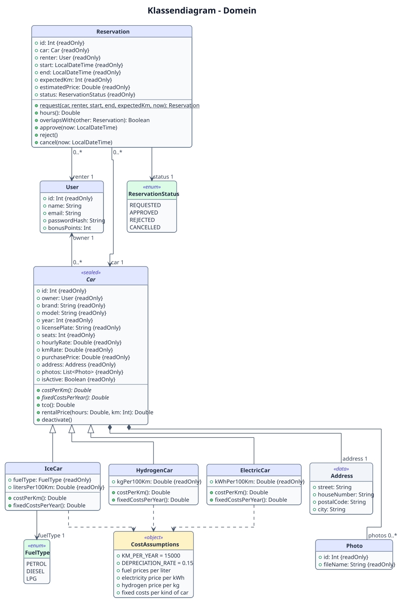

# 2. Ontwerp

In dit hoofdstuk staat hoe de applicatie is opgebouwd. Eerst het domeinmodel: de klassen die de wereld van Rent my car beschrijven. Daarna de indeling in packages en het databasemodel.

**Twee begrippen die in dit hoofdstuk vaak terugkomen:**
- **Domein:** de wereld waar de applicatie over gaat: auto's, gebruikers en reserveringen, en de regels die daarbij horen. Bijvoorbeeld: "een reservering duurt minimaal 1 uur". Die regels gelden ook zonder computer. Het *domeinmodel* zijn de klassen die deze wereld beschrijven.
- **Repository:** een technisch onderdeel dat domeinobjecten opslaat in de database en weer ophaalt. Een repository bedenkt geen regels, maar bewaart alleen. De repositories staan in het implementatie-klassendiagram in hoofdstuk 3.

## 2.1 Domeinmodel (klassendiagram)

Bron: [`puml/domain-class-diagram.puml`](puml/domain-class-diagram.puml)

De namen in de code zijn Engels. De belangrijkste vertalingen:

| Code | Betekenis |
|---|---|
| `Car`, `IceCar`, `ElectricCar`, `HydrogenCar` | Auto, ICE-auto, BEV (elektrisch), FCEV (waterstof) |
| `User` | Gebruiker (als eigenaar of als huurder) |
| `Reservation` | Reservering |
| `REQUESTED`, `APPROVED`, `REJECTED`, `CANCELLED` | Aangevraagd, goedgekeurd, afgewezen, geannuleerd |
| `PETROL`, `DIESEL`, `LPG` | Benzine, diesel, LPG |

### Toelichting per klasse

**`User`** is een gebruiker van het platform. Een gebruiker kan eigenaar zijn van auto's en huurder van reserveringen. Het wachtwoord wordt alleen gehasht opgeslagen (`passwordHash`). De bonuspunten worden in periode 2 gebruikt.

**`Car`** bevat alles wat voor elke auto geldt: merk, model, kenteken, tarieven, adres, foto's en de eigenaar. `Car` is een *sealed class*. Je kunt dus geen "losse" `Car` maken, maar alleen een van de drie soorten. De klasse heeft twee abstracte functies die elke soort zelf invult:
- `costPerKm()`: de kosten per kilometer, berekend met het verbruik en de energieprijs van die soort;
- `fixedCostsPerYear()`: de vaste kosten per jaar (verzekering, wegenbelasting en onderhoud) van die soort.

De functie `tco()` staat één keer in `Car` en gebruikt deze twee functies. Daardoor werkt de TCO-berekening voor alle soorten auto's, zonder dat de code drie keer hoeft te worden geschreven. De formules staan in `aannames.md`.

**`IceCar`, `ElectricCar` en `HydrogenCar`** zijn de drie soorten auto's uit de casus (ICE, BEV en FCEV). Ze voegen hun eigen verbruik toe en berekenen daarmee hun kosten per kilometer:

| Klasse | Eigen gegevens | Kosten per km |
|---|---|---|
| `IceCar` | `fuelType`, `litersPer100Km` | liters per 100 km × prijs van de brandstofsoort ÷ 100 |
| `ElectricCar` | `kWhPer100Km` | kWh per 100 km × stroomprijs ÷ 100 |
| `HydrogenCar` | `kgPer100Km` | kg per 100 km × waterstofprijs ÷ 100 |

**`FuelType`** is een *enum* met de drie brandstofsoorten van een ICE-auto. Elke soort heeft zijn eigen prijs per liter.

**`Address`** is het adres waar de auto staat. Het is een *data class*: het bevat alleen gegevens.

**`Photo`** is een foto van een auto. Alleen de bestandsnaam wordt opgeslagen; het bestand zelf staat op de schijf van de server.

**`Reservation`** is een reservering van een auto door een huurder, met een start- en eindmoment, het verwachte aantal kilometers en een status. De klasse bevat de regels die alleen over de reservering zelf gaan:
- bij het maken wordt gecontroleerd dat het eindmoment na het startmoment ligt en dat de duur minimaal 1 uur is;
- `estimatedPrice()` berekent de geschatte huurprijs: uurtarief × uren + km-tarief × verwachte kilometers;
- `overlapsWith()` controleert of twee reserveringen in tijd overlappen;
- `approve()`, `reject()` en `cancel()` veranderen de status, maar alleen als dat volgens de levenscyclus mag (zie hoofdstuk 1.4).

**`ReservationStatus`** is een *enum* met de vier statussen van een reservering.

**`CostAssumptions`** is een *object* (er bestaat er maar één van) met de vaste waarden uit `aannames.md`, zoals het aantal kilometers per jaar, het afschrijvingspercentage en de stroom- en waterstofprijs.

## 2.2 Toelichting op de OO-keuzes

### Gebruikte OO-concepten

| Concept | Waar in het domeinmodel | Waarom |
|---|---|---|
| **Overerving** | `IceCar`, `ElectricCar` en `HydrogenCar` erven van `Car`. | De drie soorten hebben veel gegevens gemeenschappelijk. Die staan één keer in `Car`. |
| **Abstracte klasse (sealed class)** | `Car` | Een auto is altijd een van de drie soorten. Een *sealed class* legt vast dat er precies deze drie soorten zijn. Dit is dezelfde opbouw als `Property` in de HousingMarket-workshop van les 3. |
| **Polymorfisme** | `costPerKm()` en `fixedCostsPerYear()` | Overal in de code wordt dezelfde functie aangeroepen; elke soort auto voert zijn eigen versie uit. `tco()` hoeft niet te weten welke soort auto het is. |
| **Compositie** | `Car` ◆ `Address` en `Car` ◆ `Photo` | Een adres en foto's horen bij precies één auto en bestaan niet zonder die auto. Wordt de auto verwijderd, dan verdwijnen ze ook. |
| **Associatie** | `Car` → `User` (eigenaar), `Reservation` → `Car` en `Reservation` → `User` (huurder) | Deze objecten bestaan los van elkaar. Een gebruiker blijft bestaan als zijn auto wordt verwijderd. |
| **Enum** | `FuelType`, `ReservationStatus` | Een vaste, kleine lijst mogelijkheden. `FuelType` heeft per soort een eigen prijs. |
| **Object (singleton)** | `CostAssumptions` | Alle vaste getallen staan op één plek. Als een prijs verandert, hoeft dat maar op één plek te worden aangepast. |
| **Encapsulatie** | De status van `Reservation` | De status kan alleen veranderen via `approve()`, `reject()` en `cancel()`. Die functies controleren eerst of de overgang mag. Zo kan een afgewezen reservering bijvoorbeeld nooit meer worden goedgekeurd. |
| **Data class** | `Address` | Een klasse die alleen gegevens bevat. Kotlin maakt automatisch onder andere `equals()` en `toString()`. |

### Keuze: de overlapcontrole zit in `Reservation`

Bij het goedkeuren van een aanvraag moet worden gecontroleerd of de auto in die periode al is verhuurd. Dit bestaat uit twee stappen:
1. **de regel:** overlappen twee periodes? Dit is pure logica en zit in `Reservation.overlapsWith()`;
2. **het opzoeken** van de andere goedgekeurde reserveringen van dezelfde auto. Daarvoor is de database nodig, dus dit gebeurt in de service (hoofdstuk 3).

Twee periodes overlappen als de ene begint voordat de andere eindigt, en andersom. Een reservering die eindigt op het moment dat de volgende begint, overlapt dus niet.

Deze keuze is vergelijkbaar met de HousingMarket-workshop uit les 3: daar zit de regel "wordt dit bod geaccepteerd?" (`isAccepted()`) ook in de klasse `Property` zelf. Het voordeel is dat de regel eenvoudig met unit tests te controleren is, zonder database.

### Keuze: de interfaces staan bij de repositories

In het domeinmodel staat geen interface. Er is in het domein geen onderdeel waar een interface echt iets toevoegt, en een verzonnen interface maakt het ontwerp alleen ingewikkelder. Interfaces worden wel gebruikt bij de repositories (bijvoorbeeld `CarRepository`). Daar zorgen ze ervoor dat de rest van de code niet afhangt van de database, zodat in de tests een nep-versie kan worden gebruikt. Dit staat in het implementatie-klassendiagram in hoofdstuk 3. Deze werkwijze komt uit les 3 (`EmployeeRepository`), les 7 (`FakeTaskRepository`) en de voorbeeldapplicatie van de docent (`FakeUserRepository`).

### Keuze: bedragen als `Double`

Bedragen worden opgeslagen als `Double`. Dat is eenvoudig, maar kan kleine afrondingsverschillen geven (bijvoorbeeld € 0,1452 in plaats van € 0,15). Bij het tonen van bedragen worden ze daarom afgerond op twee decimalen. Voor een echte betaalapplicatie zou een type zonder afrondingsfouten nodig zijn; omdat er in deze applicatie geen echte betalingen zijn, is `Double` voldoende.

## 2.3 Packagediagram
_Nog in te vullen._

## 2.4 Entiteit-relatiediagram (ERD)
_Nog in te vullen._

## 2.5 Relationeel databasemodel
_Nog in te vullen._
