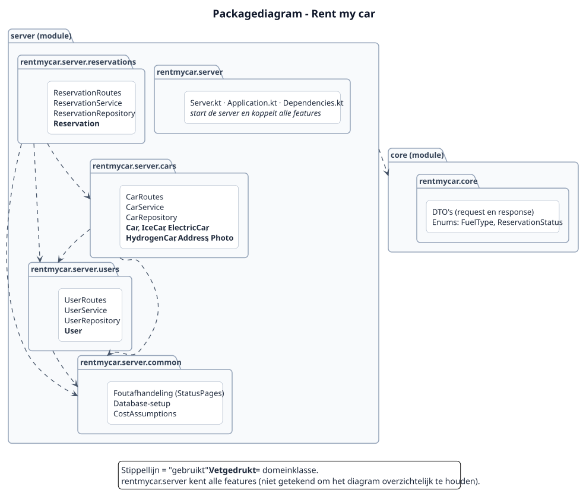
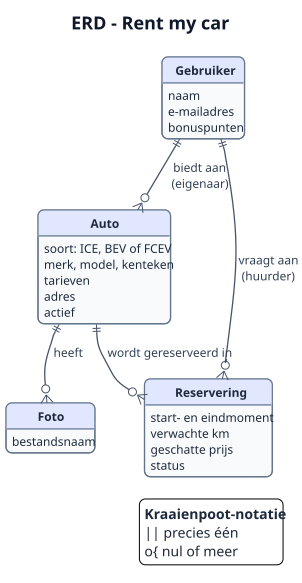
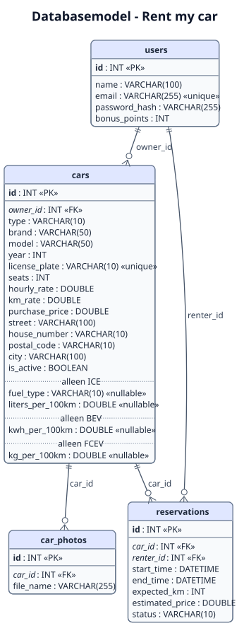

# 2. Ontwerp

In dit hoofdstuk staat hoe de applicatie is opgebouwd. Eerst het domeinmodel: de klassen die de wereld van Rent my car beschrijven. Daarna de indeling in packages en het databasemodel.

**Twee begrippen die in dit hoofdstuk vaak terugkomen:**
- **Domein:** de wereld waar de applicatie over gaat: auto's, gebruikers en reserveringen, en de regels die daarbij horen. Bijvoorbeeld: "een reservering duurt minimaal 1 uur". Die regels gelden ook zonder computer. Het *domeinmodel* zijn de klassen die deze wereld beschrijven.
- **Repository:** een technisch onderdeel dat domeinobjecten opslaat in de database en weer ophaalt. Een repository bedenkt geen regels, maar bewaart alleen. De repositories staan in de architectuur in hoofdstuk 3.1.

## 2.1 Domeinmodel (klassendiagram)


Bron: [`puml/domain-class-diagram.puml`](puml/domain-class-diagram.puml)

De namen in de code zijn Engels. De belangrijkste vertalingen:

| Code | Betekenis |
|---|---|
| `Car`, `IceCar`, `ElectricCar`, `HydrogenCar` | Auto, ICE-auto, BEV (elektrisch), FCEV (waterstof) |
| `User` | Gebruiker (als eigenaar of als huurder) |
| `Reservation` | Reservering |
| `REQUESTED`, `APPROVED`, `REJECTED`, `CANCELLED` | Aangevraagd, goedgekeurd, afgewezen, geannuleerd |
| `PETROL`, `DIESEL`, `LPG` | Benzine, diesel, LPG |

### Toelichting per klasse

**`User`** is een gebruiker van het platform. Een gebruiker kan eigenaar zijn van auto's en huurder van reserveringen. Het wachtwoord wordt alleen gehasht opgeslagen (`passwordHash`). De bonuspunten beginnen op 0 en worden in periode 2 gebruikt.

**`Car`** bevat alles wat voor elke auto geldt: merk, model, kenteken, tarieven, adres en de eigenaar. `Car` is een *sealed class*. Je kunt dus geen "losse" `Car` maken, maar alleen een van de drie soorten. Bij het maken controleert de klasse de invoer met `require()`: merk, model en kenteken zijn verplicht, er is minstens 1 zitplaats en tarieven en aanschafprijs zijn niet negatief. De klasse heeft twee abstracte functies die elke soort zelf invult:
- `costPerKm()`: de kosten per kilometer, berekend met het verbruik en de energieprijs van die soort;
- `fixedCostsPerYear()`: de vaste kosten per jaar (verzekering, wegenbelasting en onderhoud) van die soort.

Daarnaast heeft `Car`:
- `rentalPrice(hours, km)`: de huurprijs voor een aantal uren en kilometers (uurtarief × uren + km-tarief × km);
- `isActive` en `deactivate()`: een auto wordt niet echt verwijderd, maar op niet actief gezet (zie hoofdstuk 1.4). `isActive` kan alleen via `deactivate()` veranderen (`private set`);
- `NEW_ID` in het *companion object*: het id (0) van een auto die nog niet is opgeslagen. De database geeft bij het opslaan het echte id.

De functie `tco()` staat één keer in `Car` en gebruikt de twee abstracte functies. Daardoor werkt de TCO-berekening voor alle soorten auto's, zonder dat de code drie keer hoeft te worden geschreven. De formules staan in `aannames.md`.

**`IceCar`, `ElectricCar` en `HydrogenCar`** zijn de drie soorten auto's uit de casus (ICE, BEV en FCEV). Ze voegen hun eigen verbruik toe en berekenen daarmee hun kosten per kilometer:

| Klasse | Eigen gegevens | Kosten per km |
|---|---|---|
| `IceCar` | `fuelType`, `litersPer100Km` | liters per 100 km × literprijs van de brandstofsoort ÷ 100 |
| `ElectricCar` | `kWhPer100Km` | kWh per 100 km × stroomprijs ÷ 100 |
| `HydrogenCar` | `kgPer100Km` | kg per 100 km × waterstofprijs ÷ 100 |

**`FuelType`** is een *enum* met de drie brandstofsoorten van een ICE-auto. De enum staat in de gedeelde module `core`, omdat de app in periode 2 ook moet weten welke brandstofsoorten er zijn. De prijzen staan niet in de enum maar in `CostAssumptions`, omdat de app die niet nodig heeft.

**`Address`** is het adres waar de auto staat. Het is een *data class*: het bevat alleen gegevens.

**`Photo`** *(periode 2, nog niet gerealiseerd)*: een foto van een auto. Het plan is dat alleen de bestandsnaam in de database komt en het bestand zelf op de schijf van de server. Deze klasse staat daarom nog niet in het klassendiagram.

**`Reservation`** is een reservering van een auto door een huurder, met een start- en eindmoment, het verwachte aantal kilometers en een status. De klasse bevat de regels die alleen over de reservering zelf gaan:
- een nieuwe reservering wordt gemaakt met de functie `Reservation.request(...)` in het *companion object*. Die controleert eerst alle regels (de huurder is niet de eigenaar, de start ligt in de toekomst, het eindmoment ligt na het startmoment, de duur is minimaal 1 uur, het verwachte aantal kilometers is niet negatief), berekent de prijs en geeft een reservering met status `REQUESTED` terug. Zo kan er nooit een reservering bestaan die niet aan de regels voldoet;
- `estimatedPrice` is de geschatte huurprijs. Die wordt bij het aanvragen één keer berekend met `car.rentalPrice()` en daarna vastgelegd. Als de eigenaar later zijn tarieven aanpast, blijft de prijs van de reservering gelijk;
- `hours()` geeft het aantal uren van de reservering;
- `overlapsWith()` controleert of twee reserveringen in tijd overlappen;
- `approve()`, `reject()` en `cancel()` veranderen de status, maar alleen als dat volgens de levenscyclus mag (zie hoofdstuk 1.4). De status zelf heeft een `private set`.

De functies die van de tijd afhangen (`request()`, `approve()` en `cancel()`) krijgen de huidige tijd mee als parameter (`now`), in plaats van zelf de klok te lezen. Daardoor kunnen ze met een vaste tijd worden getest: bijvoorbeeld "wat gebeurt er als de start al voorbij is?".

**`ReservationStatus`** is een *enum* met de vier statussen van een reservering.

**`CostAssumptions`** is een *object* (er bestaat er maar één van) met alle vaste waarden uit `aannames.md`: het aantal kilometers per jaar, het afschrijvingspercentage, de prijzen van brandstof, stroom en waterstof, en de vaste kosten per soort auto.

## 2.2 Toelichting op de OO-keuzes

### Gebruikte OO-concepten

| Concept | Waar in het domeinmodel | Waarom |
|---|---|---|
| **Overerving** | `IceCar`, `ElectricCar` en `HydrogenCar` erven van `Car`. | De drie soorten hebben veel gegevens gemeenschappelijk. Die staan één keer in `Car`. |
| **Abstracte klasse (sealed class)** | `Car` | Een auto is altijd een van de drie soorten. Een *sealed class* legt vast dat er precies deze drie soorten zijn. Dit is dezelfde opbouw als `Property` in de HousingMarket-workshop van les 3. |
| **Polymorfisme** | `costPerKm()` en `fixedCostsPerYear()` | Overal in de code wordt dezelfde functie aangeroepen; elke soort auto voert zijn eigen versie uit. `tco()` hoeft niet te weten welke soort auto het is. |
| **Compositie** | `Car` ◆ `Address` (en in periode 2 `Car` ◆ `Photo`) | Een adres hoort bij precies één auto en bestaat niet zonder die auto. Het wordt nooit los van de auto gebruikt. |
| **Associatie** | `Car` → `User` (eigenaar), `Reservation` → `Car` en `Reservation` → `User` (huurder) | Deze objecten bestaan los van elkaar. Een gebruiker blijft bestaan als zijn auto wordt verwijderd. |
| **Enum** | `FuelType`, `ReservationStatus` (en `CarType` in de DTO's) | Een vaste, kleine lijst mogelijkheden. |
| **Object (singleton)** | `CostAssumptions` | Alle vaste getallen staan op één plek. Als een prijs verandert, hoeft dat maar op één plek te worden aangepast. |
| **Encapsulatie** | De status van `Reservation` | De status kan alleen veranderen via `approve()`, `reject()` en `cancel()`. Die functies controleren eerst of de overgang mag. Zo kan een afgewezen reservering bijvoorbeeld nooit meer worden goedgekeurd. |
| **Companion object** | `Reservation.request(...)`, `Car.NEW_ID`, `Reservation.NEW_ID` | Iets dat bij de klasse hoort en niet bij één object. `request()` maakt een nieuwe reservering en controleert eerst alle regels; dit is een eenvoudige vorm van het *factory*-patroon. |
| **Data class** | `Address` | Een klasse die alleen gegevens bevat. Kotlin maakt automatisch onder andere `equals()` en `toString()`. |

### Keuze: de overlapcontrole zit in `Reservation`

Bij het goedkeuren van een aanvraag moet worden gecontroleerd of de auto in die periode al is verhuurd. Dit bestaat uit twee stappen:
1. **de regel:** overlappen twee periodes? Dit is pure logica en zit in `Reservation.overlapsWith()`;
2. **het opzoeken** van de andere goedgekeurde reserveringen van dezelfde auto. Daarvoor is de database nodig, dus dit gebeurt in de service (hoofdstuk 3).

Twee periodes overlappen als de ene begint voordat de andere eindigt, en andersom. Een reservering die eindigt op het moment dat de volgende begint, overlapt dus niet.

Deze keuze is vergelijkbaar met de HousingMarket-workshop uit les 3: daar zit de regel "wordt dit bod geaccepteerd?" (`isAccepted()`) ook in de klasse `Property` zelf. Het voordeel is dat de regel eenvoudig met unit tests te controleren is, zonder database.

### Keuze: de interfaces staan bij de repositories

In het domeinmodel staat geen interface. Er is in het domein geen onderdeel waar een interface echt iets toevoegt, en een verzonnen interface maakt het ontwerp alleen ingewikkelder. Interfaces worden wel gebruikt bij de repositories (bijvoorbeeld `CarRepository`). Daar zorgen ze ervoor dat de rest van de code niet afhangt van de database, zodat in de tests een nep-versie kan worden gebruikt. Dit staat in het architectuurdiagram in hoofdstuk 3.1. Deze werkwijze komt uit les 3 (`EmployeeRepository`), les 7 (`FakeTaskRepository`) en de voorbeeldapplicatie van de docent (`FakeUserRepository`).

### Keuze: bedragen als `Double`

Bedragen worden opgeslagen als `Double`. Dat is eenvoudig, maar kan kleine afrondingsverschillen geven. Bij het versturen worden bedragen daarom afgerond met de functie `rounded()` uit `common/Rounding.kt`: de huurprijs en de TCO op twee decimalen, en de kosten per km op vier decimalen (bijvoorbeeld € 0,1452), omdat dat bedrag zo klein is. Voor een echte betaalapplicatie zou een type zonder afrondingsfouten nodig zijn; omdat er in deze applicatie geen echte betalingen zijn, is `Double` voldoende.

## 2.3 Packagediagram



Bron: [`puml/package-diagram.puml`](puml/package-diagram.puml)

De code van de server is ingedeeld **per feature**: elk onderdeel van de casus heeft een eigen package. Binnen elke feature staan dezelfde lagen: routes, service en repository (zie hoofdstuk 3.1).

| Package | Inhoud |
|---|---|
| `rentmycar.server` | Het starten van de server en het inlezen van de instellingen (`Server.kt`), het installeren van de plugins en het koppelen van de routes (`Application.kt`), het aanmaken van alle services en repositories (`Dependencies.kt`), het verbinden met de database en het maken van de tabellen (`DatabaseFactory.kt`) en het vullen van een lege database met testdata (`DemoData.kt`). |
| `rentmycar.server.users` | Gebruikers: registreren, inloggen, het domeinobject `User`, de tabel `UserTable`, het hashen van wachtwoorden (`PasswordHasher`) en het maken en controleren van tokens (`TokenService`, met de instellingen in `JwtConfig`). |
| `rentmycar.server.cars` | Auto's: aanbieden, zoeken, wijzigen, verwijderen, kosten berekenen, de tabel `CarTable` en de domeinklassen `Car`, `IceCar`, `ElectricCar`, `HydrogenCar` en `Address`. Foto's (`Photo`) volgen in periode 2. |
| `rentmycar.server.reservations` | Reserveringen: aanvragen, goedkeuren, afwijzen, annuleren, de tabel `ReservationTable` en het domeinobject `Reservation`. |
| `rentmycar.server.common` | Onderdelen die alle features gebruiken: de foutafhandeling (`StatusPages.kt` en `Exceptions.kt`), hulpfuncties voor een verzoek (`CallUtils.kt`: het gebruikers-id uit het token en een getal uit de URL), afronden (`Rounding.kt`), tijd (`TimeUtils.kt`) en `CostAssumptions`. |
| `rentmycar.core` | De gedeelde module met de DTO's, `ApiError` en de enums `CarType`, `FuelType` en `ReservationStatus`. |

Elke feature heeft ook een bestand `...Mapping.kt` met de functie `toResponse()`, die een domeinobject omzet naar een DTO. Het omzetten van een databaserij naar een domeinobject gebeurt in de repository zelf.

**Afhankelijkheden:**
- `reservations` gebruikt `cars` en `users`, omdat een reservering een auto en een huurder heeft;
- `cars` gebruikt `users`, omdat een auto een eigenaar heeft;
- `users` gebruikt geen andere feature. Er zijn dus geen kringen: de afhankelijkheden lopen maar één kant op;
- alle features gebruiken `common` en de gedeelde module `core`.

**Wat staat in `core` en wat in `server`?**
- In `core` staan alleen de **DTO's** (*Data Transfer Objects*: de gegevens die als JSON tussen de app en de server worden verstuurd) en de **enums**. De Android-app gebruikt in periode 2 precies dezelfde klassen. Zo kunnen de app en de server niet van elkaar verschillen.
- De **domeinklassen** met hun regels en berekeningen staan in `server`. De regels worden alleen op de server uitgevoerd; de app krijgt de uitkomsten via de DTO's.

## 2.4 Entiteit-relatiediagram (ERD)



Bron: [`puml/erd.puml`](puml/erd.puml)

Het ERD laat zien welke gegevens de applicatie bewaart en hoe ze samenhangen, nog zonder technische details. Het diagram gebruikt de kraaienpoot-notatie.

| Relatie | Betekenis |
|---|---|
| Gebruiker – Auto | Een gebruiker biedt nul of meer auto's aan. Een auto heeft precies één eigenaar. |
| Gebruiker – Reservering | Een gebruiker vraagt nul of meer reserveringen aan. Een reservering heeft precies één huurder. |
| Auto – Reservering | Een auto heeft nul of meer reserveringen. Een reservering is voor precies één auto. |
| Auto – Foto | Een auto heeft nul of meer foto's. Een foto hoort bij precies één auto. *Volgt in periode 2 (gestippeld in het ERD).* |

## 2.5 Relationeel databasemodel



Bron: [`puml/database-model.puml`](puml/database-model.puml)

De gegevens worden opgeslagen in drie tabellen: `users`, `cars` en `reservations`. In de code worden deze tabellen beschreven met de library Exposed (`UserTable`, `CarTable` en `ReservationTable`). `DatabaseFactory` maakt de tabellen bij het starten als ze nog niet bestaan. De database staat in het bestand `data/rentmycar.mv.db`, zodat de gegevens na een herstart bewaard blijven; de tests gebruiken een database in het geheugen.

In periode 2 komt er een vierde tabel bij: `car_photos`, voor de foto's van een auto.

### Vertaling van het OO-model naar tabellen

Een database kent geen klassen, overerving of lijsten, maar alleen tabellen met kolommen. Het domeinmodel uit 2.1 is daarom als volgt vertaald:

| In Kotlin | In de database | Voorbeeld | Bron |
|---|---|---|---|
| Klasse | Tabel | `User` → `users` | Algemeen |
| Eigenschap | Kolom | `licensePlate` → `license_plate` | Algemeen |
| Associatie | Vreemde sleutel (FK) | De eigenaar van `Car` → `owner_id` verwijst naar `users` | Algemeen |
| Compositie met één object | Kolommen in dezelfde tabel | `Address` → `street`, `house_number`, `postal_code`, `city` in `cars` | Eigen keuze |
| Compositie met een lijst (periode 2) | Aparte tabel met een FK | `photos` → tabel `car_photos` met `car_id` | Zoals `IncidentImagesTable` in de demo van de docent |
| Overerving | Eén tabel met een kolom `type` | `IceCar`, `ElectricCar`, `HydrogenCar` → `cars` | Eigen keuze, zie hieronder |
| Enum | De naam als tekst | `FuelType.PETROL` → `'PETROL'` | Les 7: `enumerationByName` |
| Tijdstip | `DATETIME` | `start` → `start_time` | Algemeen |

De kolommen `start` en `end` heten in de database `start_time` en `end_time`, omdat `end` in SQL een gereserveerd woord is.

### Keuze: overerving in één tabel

Voor het opslaan van de drie soorten auto's zijn drie bekende manieren (uit *Patterns of Enterprise Application Architecture* van Martin Fowler). Deze manieren komen niet uit het lesmateriaal; de keuze is mijn eigen afweging.

| Manier | Hoe | Voordelen | Nadelen |
|---|---|---|---|
| **A. Eén tabel** (*Single Table Inheritance*) ✅ | Alle auto's in de tabel `cars`, met een kolom `type` en de kolommen van alle soorten | Eenvoudig: één tabel, zoeken over alle auto's is één query, een reservering verwijst naar één tabel | Sommige kolommen zijn leeg, afhankelijk van de soort |
| B. Een tabel per soort plus een gedeelde tabel (*Class Table Inheritance*) | Gedeelde gegevens in `cars`, eigen gegevens in `ice_cars`, `electric_cars` en `hydrogen_cars` | Geen lege kolommen | Vier tabellen; elke query moet tabellen samenvoegen (joins) |
| C. Een losse tabel per soort (*Concrete Table Inheritance*) | Drie tabellen met elk alle kolommen | Geen lege kolommen | Zoeken over alle auto's is lastig, en een reservering zou naar drie tabellen moeten kunnen verwijzen |

Ik heb gekozen voor **A**, omdat dit het eenvoudigst te bouwen en te begrijpen is. De lege kolommen zijn een bewuste afweging: er zijn maar vier extra kolommen. Bij het uitlezen bepaalt de kolom `type` welke klasse wordt gemaakt:

```kotlin
// Make the right kind of car from a database row (shortened)
val type = row[CarTable.type]
if (type == CarType.ICE) {
    return IceCar(...)
}
if (type == CarType.BEV) {
    return ElectricCar(...)
}
return HydrogenCar(...)
```

De kolom `type` is de enum `CarType`, opgeslagen als tekst (`enumerationByName`). Dit staat in de functie `toCar()` van `ExposedCarRepository`.

### Keuze: auto's worden niet echt verwijderd

De tabel `cars` heeft een kolom `is_active`. Als een eigenaar zijn auto verwijdert, wordt `is_active` op `false` gezet en blijft de rij bestaan (*soft delete*). Daardoor blijven de reserveringen die naar deze auto verwijzen geldig, en kan een huurder zijn oude reserveringen blijven zien. Bij het zoeken worden alleen auto's met `is_active = true` getoond. Een niet-actieve auto geeft bij opvragen, wijzigen, verwijderen en reserveren een 404.

### Keuze: de huurprijs wordt vastgelegd

De tabel `reservations` heeft een kolom `estimated_price`. De prijs wordt bij het aanvragen berekend en opgeslagen. Als de eigenaar later zijn tarieven verandert, blijft de prijs van een bestaande reservering hetzelfde, net als bij een echte boeking.

### Unieke waarden

- `users.email` is uniek: met één e-mailadres kun je maar één account maken.
- `cars.license_plate` is uniek: een auto kan maar één keer worden aangeboden.
