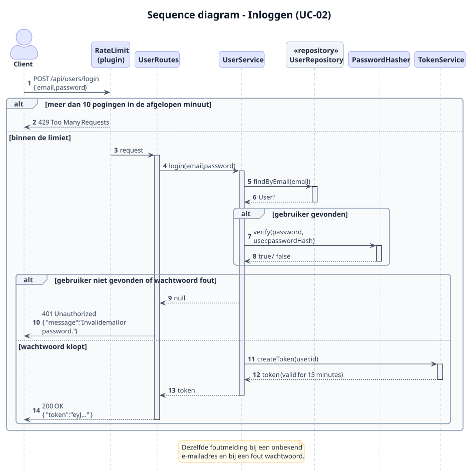
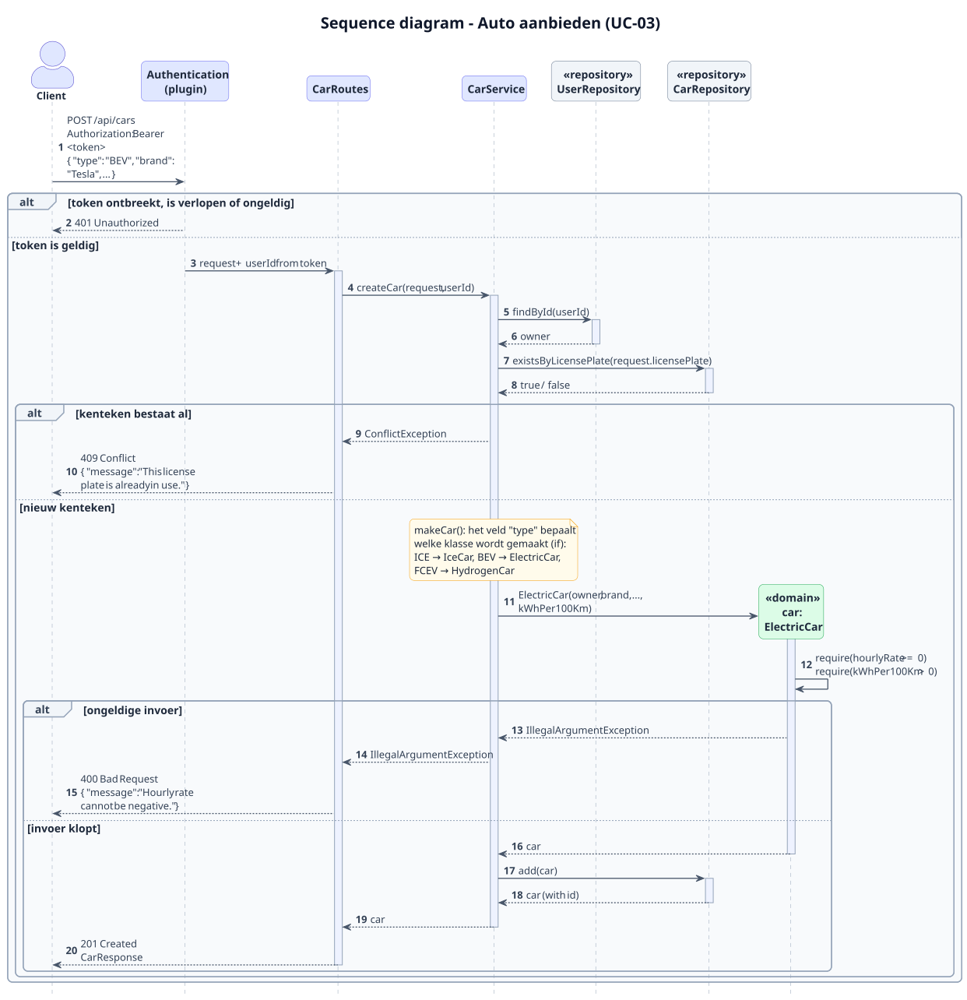
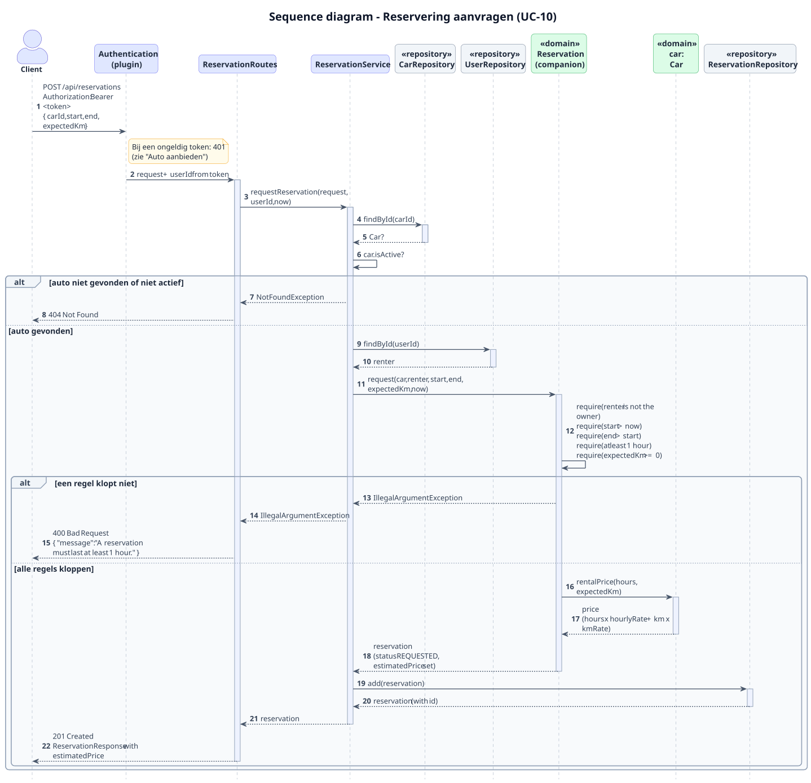
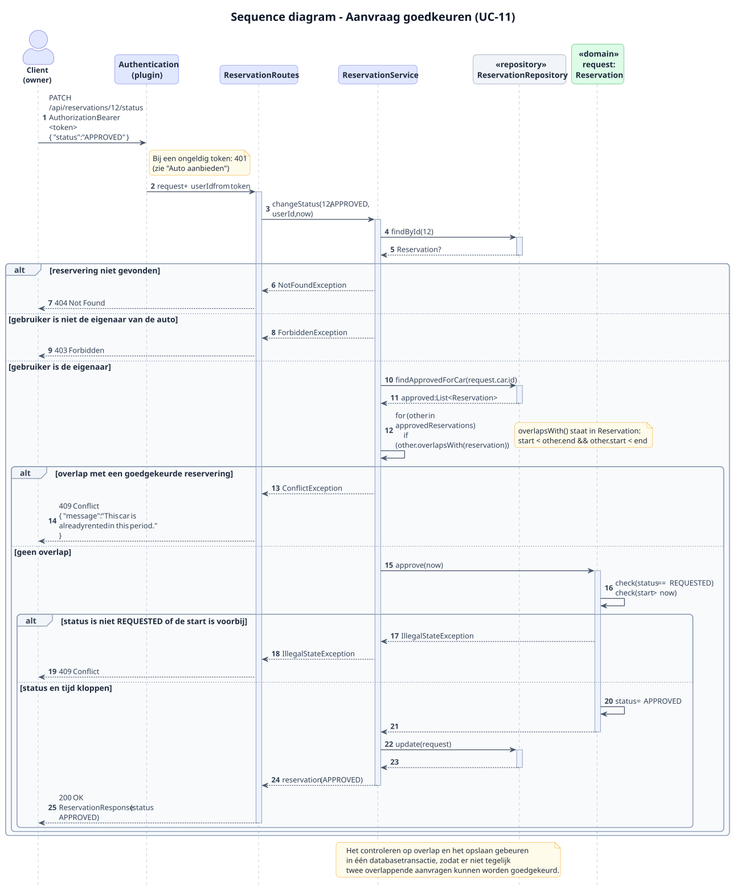

# 3. Web API

## 3.1 Architectuur


Bron: [`puml/architecture.puml`](puml/architecture.puml)

### Lagen

Elk verzoek dat bij de server binnenkomt, gaat door dezelfde lagen. Elke laag heeft één verantwoordelijkheid:

| Laag | Verantwoordelijkheid | Voorbeeld |
|---|---|---|
| **Plugins** | Algemene zaken voor alle verzoeken: JSON omzetten, controleren of de gebruiker is ingelogd (JWT) en fouten omzetten naar een nette foutmelding. | Een verzoek zonder geldig token krijgt status 401. |
| **Routes** | Alleen HTTP: het verzoek uitlezen, de service aanroepen en een antwoord met de juiste statuscode terugsturen. De route zet het antwoord om naar een DTO met `toResponse()`. | `PATCH /api/reservations/{id}/status` roept `ReservationService.changeStatus()` aan. |
| **Service** | Een use case uitvoeren: de stappen coördineren en de regels toepassen. | Bij goedkeuren: de aanvraag ophalen, controleren dat de gebruiker de eigenaar is, controleren op overlap en de nieuwe status opslaan. |
| **Domein** | De klassen en regels van Rent my car (hoofdstuk 2). Het domein weet niets van HTTP of de database. | `reservation.overlapsWith(other)` |
| **Repository** | Domeinobjecten opslaan en ophalen. De service praat alleen met de *interface*; de echte versie gebruikt Exposed en de H2-database. | `ExposedReservationRepository` |

Doordat de service alleen de interface van de repository kent, kan in de tests een nep-versie (`FakeRepository`) worden meegegeven. Dan kunnen de routes en services worden getest zonder database (zie hoofdstuk 4).

### Indeling per feature

De lagen zitten niet in één grote map per laag, maar in een package per feature (`users`, `cars`, `reservations`; zie het packagediagram in hoofdstuk 2.3). Alles wat bij auto's hoort, staat dus bij elkaar. Binnen elke feature zijn de lagen wel te herkennen aan de bestandsnamen:

```
server/src/
├── Server.kt           main(): laadt de instellingen en start de server
├── Application.kt      installeert de plugins en koppelt de routes
├── Dependencies.kt     maakt alle repositories en services aan
├── DatabaseFactory.kt  verbindt met H2 en maakt de tabellen
├── DemoData.kt         vult een lege database met testdata
├── users/
├── cars/
│   ├── CarRoutes.kt       routes
│   ├── CarService.kt      service
│   ├── CarRepository.kt   interface + ExposedCarRepository
│   ├── CarTable.kt        de tabel voor Exposed
│   ├── CarMapping.kt      domeinobject -> DTO
│   └── Car.kt, IceCar.kt, ElectricCar.kt, HydrogenCar.kt, Address.kt   domein
├── reservations/
└── common/
```

### Onderdelen aan elkaar koppelen (dependency injection)

In `Dependencies.kt` worden alle repositories en services één keer aangemaakt en als parameter aan elkaar doorgegeven:

```kotlin
// Makes all repositories and services once and passes them to each other (shortened)
val userRepository = ExposedUserRepository(database)
val carRepository = ExposedCarRepository(database, userRepository)
val reservationRepository = ExposedReservationRepository(database, carRepository, userRepository)

val carService = CarService(carRepository, userRepository, reservationRepository)
val reservationService = ReservationService(reservationRepository, carRepository, userRepository)
```

Hiervoor wordt geen apart framework gebruikt. Het is gewone Kotlin-code die in volgorde wordt uitgevoerd, dus makkelijk te volgen. In een test wordt op dezelfde manier een service gemaakt, maar dan met fake repositories (`FakeCarRepository`, `FakeReservationRepository` en `FakeUserRepository`).

### Herkomst van de keuzes

| Keuze | Bron | Afwijking? |
|---|---|---|
| Scheiding in routes, service, domein en repository | Leeruitkomst 1 ("scheidt verantwoordelijkheden: routing, use-cases/service, domein, persistence"); les 3 en 4 ("klassieke 3-lagen: route, services en repository"); les 6 ("toepassen service layer") | Nee |
| Indeling per feature (`users`, `cars`, `reservations`) | Gastles Ktor (`nomisRev/avans-toolchain-and-ktor-2026`, *architecture*: "Keep feature code together"); voorbeeldapplicatie van de docent (`auth`, `users`, `incidents`) | Nee |
| `Server.kt`, `Application.kt` en `Dependencies.kt` | Gastles Ktor ("Bootstrap constructs; application wires"); voorbeeldapplicatie van de docent (`Dependencies.kt`) | Nee |
| Interfaces alleen voor repositories | Gastles Ktor: "Don't create an interface for every class automatically" | Nee |
| Fake repositories in tests | Les 7 (`FakeTaskRepository`); voorbeeldapplicatie van de docent (`FakeUserRepository`) | Nee |
| **Geen Koin** voor dependency injection | Gastles Ktor: "dependency injection without a framework" | **Ja.** Op Brightspace (*Handige overzichten*) wordt Koin aanbevolen. Ik volg het advies van de gastles, omdat het zonder framework eenvoudiger is en voor deze applicatie voldoende. |
| **Een service voor elke feature** | Les 6 ("toepassen service layer") | **Klein verschil.** De gastles zegt een service pas toe te voegen als er een echte use case is. Alle drie de features hebben regels (eigenaarschap, overlap, wachtwoorden), dus een service is hier steeds nodig. |
| **Domeinklassen in `server`**, alleen DTO's en enums in `core` | Voorbeeldapplicatie van de docent: DTO's en enums in de gedeelde module | **Ja.** In de demo van de docent staan ook de domeinmodellen in de gedeelde module. Ik houd de domeinklassen op de server, omdat de regels en berekeningen alleen daar worden uitgevoerd; de app krijgt de uitkomsten via de DTO's. |
| Module heet `core` in plaats van `shared` | De wizard maakte de module `core` aan; `app/shared` bestaat al voor de app | Alleen een andere naam |

## 3.2 Endpoints

Alle URL's beginnen met `/api`, net als in de voorbeeldapplicatie van de docent. De gegevens worden verstuurd als JSON. 🔒 betekent dat een geldig inlogtoken nodig is (zie 3.4).

### Gebruikers

| Methode en URL | Wat | Gelukt | Use case |
|---|---|---|---|
| `POST /api/users/register` | Account aanmaken | 201 + gebruiker | UC-01 |
| `POST /api/users/login` | Inloggen | 200 + token | UC-02 |
| `GET /api/users/me` 🔒 | Eigen gegevens bekijken | 200 + gebruiker | – |

### Auto's

| Methode en URL | Wat | Gelukt | Use case |
|---|---|---|---|
| `GET /api/cars` | Actieve auto's zoeken, met optionele filters (zie hieronder) | 200 + lijst | UC-08 |
| `GET /api/cars/{id}` | Details van een actieve auto | 200 + auto | UC-09 |
| `GET /api/cars/mine` 🔒 | Eigen auto's bekijken | 200 + lijst | – |
| `POST /api/cars` 🔒 | Auto aanbieden | 201 + auto | UC-03 |
| `PUT /api/cars/{id}` 🔒 eigenaar | Auto wijzigen | 200 + auto | UC-04 |
| `DELETE /api/cars/{id}` 🔒 eigenaar | Auto op niet actief zetten | 204 | UC-05 |
| `GET /api/cars/{id}/costs` 🔒 eigenaar | Kosten per km en TCO per jaar | 200 + kosten | UC-07 |

`GET /api/cars/mine` toont ook de eigen auto's die niet meer actief zijn.

**Gepland voor periode 2 (nog niet gerealiseerd):**

| Methode en URL | Wat | Gelukt | Use case |
|---|---|---|---|
| `POST /api/cars/{id}/photos` 🔒 eigenaar | Foto uploaden (`multipart/form-data`) | 201 + foto | UC-06 |
| `DELETE /api/cars/{id}/photos/{photoId}` 🔒 eigenaar | Foto verwijderen | 204 | UC-06 |
| `GET /api/photos/{fileName}` | Foto bekijken | 200 + afbeelding | UC-09 |

**Zoekfilters** bij `GET /api/cars`; alle filters zijn optioneel en kunnen worden gecombineerd:

| Parameter | Betekenis | Voorbeeld |
|---|---|---|
| `type` | Soort auto (hoofdletters maken niet uit) | `ICE`, `BEV` of `FCEV` |
| `city` | Plaats (hoofdletters maken niet uit) | `Breda` |
| `maxHourlyRate` | Maximale uurprijs | `10.0` |

Voorbeeld: `GET /api/cars?type=BEV&city=Breda&maxHourlyRate=10`

Een onbekende soort auto of een uurprijs die geen getal is, geeft 400. Filteren op beschikbaarheid in een periode (`from` en `to`) is nog niet gerealiseerd en volgt in periode 2.

### Reserveringen

| Methode en URL | Wat | Gelukt | Use case |
|---|---|---|---|
| `POST /api/reservations` 🔒 | Reservering aanvragen | 201 + reservering met geschatte prijs | UC-10 |
| `GET /api/reservations/mine` 🔒 | Eigen reserveringen als huurder | 200 + lijst | UC-12 |
| `GET /api/cars/{id}/reservations` 🔒 eigenaar | Aanvragen en reserveringen voor een eigen auto | 200 + lijst | UC-11 |
| `GET /api/reservations/{id}` 🔒 huurder of eigenaar | Details; na goedkeuring met de contactgegevens van de eigenaar | 200 + reservering | UC-12 |
| `PATCH /api/reservations/{id}/status` 🔒 | Status wijzigen: goedkeuren, afwijzen of annuleren | 200 + reservering | UC-11, UC-13 |

Het wijzigen van de status gaat via één endpoint, zoals in de voorbeeldapplicatie van de docent (`PATCH /{incidentId}/status`). De service controleert wie wat mag:

| Nieuwe status | Wie | Voorwaarde |
|---|---|---|
| `APPROVED` | Eigenaar van de auto | Status is `REQUESTED`, de start is nog niet bereikt en er is geen overlap met een andere goedgekeurde reservering |
| `REJECTED` | Eigenaar van de auto | Status is `REQUESTED` |
| `CANCELLED` | Huurder | Status is `REQUESTED` of `APPROVED` en de start is nog niet bereikt |
| `REQUESTED` | Niemand | Een reservering kan niet terug naar `REQUESTED` (400) |

Wie niet de juiste persoon is, krijgt 403. Klopt de status of het tijdstip niet, dan volgt 409.

### Voorbeelden van requests en responses

**Account aanmaken:** `POST /api/users/register`

```json
{ "name": "Sanne de Vries", "email": "sanne@example.com", "password": "Geheim123!" }
```

Antwoord `201 Created` (zonder wachtwoord):

```json
{ "id": 3, "name": "Sanne de Vries", "email": "sanne@example.com", "bonusPoints": 0 }
```

**Inloggen:** `POST /api/users/login`

```json
{ "email": "sanne@example.com", "password": "Geheim123!" }
```

Antwoord `200 OK`:

```json
{ "token": "eyJhbGciOiJIUzI1NiIsInR5cCI6IkpXVCJ9..." }
```

**Auto aanbieden:** `POST /api/cars` 🔒

```json
{
  "type": "BEV",
  "brand": "Tesla",
  "model": "Model 3",
  "year": 2023,
  "licensePlate": "R-123-XY",
  "seats": 5,
  "hourlyRate": 8.50,
  "kmRate": 0.20,
  "purchasePrice": 35000.0,
  "address": { "street": "Hogeschoollaan", "houseNumber": "1", "postalCode": "4818 CR", "city": "Breda" },
  "kWhPer100Km": 17.0
}
```

Het veld `type` bepaalt welke soort auto wordt gemaakt. Bij `ICE` horen de velden `fuelType` en `litersPer100Km`, bij `BEV` het veld `kWhPer100Km` en bij `FCEV` het veld `kgPer100Km`. Ontbreekt het verbruik dat bij de soort hoort, dan volgt 400. Antwoord `201 Created` met dezelfde gegevens plus `id`, `ownerId` en `isActive: true`.

**Kosten bekijken:** `GET /api/cars/7/costs` 🔒 eigenaar. Antwoord `200 OK` (de BEV uit het rekenvoorbeeld in `aannames.md`):

```json
{
  "costPerKm": 0.0578,
  "tcoPerYear": 8312.0,
  "kmPerYear": 15000
}
```

De kosten per km worden afgerond op vier decimalen en de TCO op twee. De opbouw van de TCO (afschrijving, verzekering, wegenbelasting, onderhoud en energie) staat in `aannames.md`; de API geeft alleen de uitkomsten terug.

**Reservering aanvragen:** `POST /api/reservations` 🔒

```json
{ "carId": 7, "start": "2026-10-20T09:00", "end": "2026-10-20T13:00", "expectedKm": 80 }
```

Antwoord `201 Created`:

```json
{
  "id": 12,
  "carId": 7,
  "renterId": 3,
  "start": "2026-10-20T09:00",
  "end": "2026-10-20T13:00",
  "expectedKm": 80,
  "estimatedPrice": 50.0,
  "status": "REQUESTED"
}
```

**Aanvraag goedkeuren:** `PATCH /api/reservations/12/status` 🔒 eigenaar

```json
{ "status": "APPROVED" }
```

Antwoord `200 OK` met de reservering, nu met `"status": "APPROVED"`. Vraagt de huurder daarna de reservering op, dan staat er ook een veld `ownerContact` in met de naam en het e-mailadres van de eigenaar.

### DTO's

De JSON-gegevens hierboven zijn in de code *DTO's* (Data Transfer Objects): eenvoudige `@Serializable` data classes in de gedeelde module `core`.

| Bestand | DTO's |
|---|---|
| `UserDtos.kt` | `RegisterRequest`, `LoginRequest`, `TokenResponse`, `UserResponse` |
| `CarDtos.kt` | `CarRequest` (voor toevoegen én wijzigen), `CarResponse`, `AddressDto`, `CostsResponse` |
| `ReservationDtos.kt` | `CreateReservationRequest`, `ChangeStatusRequest`, `ReservationResponse`, `OwnerContact` |
| `ApiError.kt` | `ApiError` (de vorm van elke foutmelding) |

De service maakt van een request-DTO een domeinobject; de route zet het domeinobject met `toResponse()` om naar een response-DTO. Zo bepaalt de API zelf welke gegevens naar buiten gaan; de wachtwoord-hash van een gebruiker komt bijvoorbeeld nooit in een response.

## 3.3 Foutafhandeling en statuscodes

Fouten worden in de code als *exception* gegooid. De Ktor-plugin **StatusPages** vangt ze op één centrale plek op en zet ze om naar een statuscode met een duidelijke melding. Zo werkt de voorbeeldapplicatie van de docent ook (`StatusPages.kt`). Elke foutmelding heeft dezelfde vorm, met de klasse `ApiError` uit de gedeelde module:

```json
{ "message": "This car is already rented in this period." }
```

| Situatie | Exception in de code | Status |
|---|---|---|
| Ongeldige invoer, bijvoorbeeld een negatief tarief, een eindmoment vóór het startmoment, ongeldige JSON of een id in de URL dat geen getal is | `IllegalArgumentException` (onder andere via `require()`) of `BadRequestException` (van Ktor) | **400** Bad Request |
| Geen geldig token, of een verkeerd e-mailadres of wachtwoord bij het inloggen | Geen exception: de authenticatie-plugin (`challenge`) of `UserRoutes` antwoordt direct | **401** Unauthorized |
| Ingelogd, maar niet de eigenaar of huurder | `ForbiddenException` (eigen klasse) | **403** Forbidden |
| Auto of reservering bestaat niet (of de auto is niet actief) | `NotFoundException` (van Ktor) | **404** Not Found |
| De actie kan nu niet: overlap, kenteken of e-mailadres bestaat al, verkeerde status, auto verwijderen met reserveringen in de toekomst | `IllegalStateException` via `check()`, of `ConflictException` (eigen klasse) | **409** Conflict |
| Te veel inlog- of registratiepogingen | Afgehandeld door de RateLimit-plugin | **429** Too Many Requests |
| Een onverwachte fout | Alle overige exceptions | **500** Internal Server Error, zonder technische details in het antwoord; de fout wordt wel gelogd |

**`require()` en `check()`:** in de domeinklassen worden deze twee Kotlin-functies gebruikt (behandeld in les 3):
- `require()` controleert de **invoer**. Voorbeeld in `Reservation`: `require(end > start)`. Gaat het mis, dan volgt 400.
- `check()` controleert de **toestand** van een object. Voorbeeld in `approve()`: `check(status == REQUESTED)`. Gaat het mis, dan volgt 409.

**401 of 403?** Een 401 betekent "we weten niet wie je bent": de app moet de gebruiker opnieuw laten inloggen. Een 403 betekent "we weten wie je bent, maar dit mag je niet": opnieuw inloggen helpt dan niet. Dit onderscheid komt uit de authentication-les van de gastdocent.

## 3.4 Authenticatie en autorisatie

**Authenticatie** is vaststellen wie de gebruiker is. **Autorisatie** is bepalen wat die gebruiker mag.

### Wachtwoorden

Wachtwoorden worden nooit leesbaar opgeslagen, maar als **hash** met het algoritme **Argon2id**:
- elk wachtwoord krijgt een eigen, willekeurige *salt*, zodat twee gelijke wachtwoorden een verschillende hash krijgen;
- de instellingen zijn dezelfde als in de demo van de gastdocent: 64 MB geheugen, 3 iteraties en een parallelliteit van 4;
- de berekening wordt gedaan met de library BouncyCastle, net als in de demo van de gastdocent.

Argon2id is de eerste keus van OWASP voor het opslaan van wachtwoorden. BCrypt wordt door OWASP alleen nog aangeraden voor oudere systemen.

### Inloggen en het token

1. De gebruiker stuurt zijn e-mailadres en wachtwoord naar `POST /api/users/login`.
2. De server berekent de hash van het ingevoerde wachtwoord met de opgeslagen salt en vergelijkt die met de opgeslagen hash.
3. Klopt het, dan krijgt de gebruiker een **JWT-token** terug. Klopt het niet, dan volgt een 401 met **dezelfde foutmelding**, of nu het e-mailadres of het wachtwoord fout is. Zo kan niemand uitzoeken welke e-mailadressen een account hebben (advies van OWASP en de gastdocent).
4. Bij elk beveiligd verzoek stuurt de app het token mee in de header: `Authorization: Bearer <token>`.

**Inhoud van het token:**

| Claim | Betekenis |
|---|---|
| `iss` | Wie het token heeft uitgegeven (de RentMyCar-server) |
| `aud` | Voor wie het token is bedoeld (de RentMyCar-API) |
| `sub` | Het id van de gebruiker |
| `iat` | Wanneer het token is gemaakt |
| `exp` | Wanneer het token verloopt |

Bij elk verzoek controleert de server de handtekening en al deze claims. Is het token verlopen, aangepast of van een andere uitgever, dan volgt een 401. De inhoud van een token is voor iedereen leesbaar; daarom staan er geen wachtwoorden of andere geheime gegevens in.

**De instellingen** (poort, host, issuer, audience, realm en de geheime sleutel) staan in `server/resources/application.conf`, net als in de voorbeeldapplicatie van de docent. Elke instelling heeft een standaardwaarde voor de eigen computer en kan worden overschreven met een omgevingsvariabele (`${?PORT}`, `${?JWT_SECRET}` enzovoort). Zo staat er op een echte server geen geheim in de code, volgens het advies "configuration lives outside the code" uit de gastles. Bij het starten worden de instellingen ingelezen in de data classes `AppConfig`, `ServerConfig` en `JwtConfig`.

**De geheime sleutel** waarmee de server tokens ondertekent, komt op een echte server uit de omgevingsvariabele `JWT_SECRET`. Twee verbeteringen ten opzichte van de docent:
- De sleutel moet **minstens 32 tekens** lang zijn; `JwtConfig` controleert dat bij het starten (zoals in de auth-demo van de gastdocent). Een korte sleutel kan iemand met één token offline raden, en dan zelf tokens maken voor elke gebruiker. De standaard voor HS256 (RFC 7518) vraagt daarom minstens 256 bits.
- Is `JWT_SECRET` niet ingesteld, dan geeft de server een **waarschuwing**, omdat de standaardsleutel uit `application.conf` in git staat en dus niet geheim is.

### Hoe lang is een token geldig?

Een token is **15 minuten** geldig. Een token werkt als een sleutel: wie het heeft, wordt als de gebruiker gezien. Een token kan niet worden ingetrokken; uitloggen in de app maakt een gekopieerd token niet ongeldig. Daarom is een korte geldigheid veiliger. De geldigheid staat als constante `VALID_MINUTES` in `TokenService` (de docent zet zijn 1 uur ook in de code).

| Bron | Geldigheid |
|---|---|
| OWASP en andere best practices | 5 tot 15 minuten, in combinatie met een refresh token |
| Gastdocent, authentication-les en auth-demo | 15 minuten, zonder refresh token |
| Gastdocent, ktor-fundamentals les 9 (sprekersnotities bij de slide "The login signs the token") | "Short lifetimes plus a refresh token is the usual pattern" |
| Docent, voorbeeldapplicatie | 1 uur |

**Beperking en vervolgstap:** zonder refresh token moet de gebruiker na 15 minuten opnieuw inloggen. In periode 1 is dat geen probleem: de API wordt getest met `.http`-bestanden, waarin het inlogverzoek opnieuw kan worden uitgevoerd. In periode 2, wanneer de Android-app de gebruiker ingelogd moet houden, is een *refresh token* gepland:
- bij het inloggen krijgt de app naast het korte token een refresh token dat langer geldig is;
- de server bewaart de refresh tokens in de database, zodat ze bij het uitloggen kunnen worden ingetrokken;
- een refresh token mag maar één keer worden gebruikt; bij gebruik krijgt de app een nieuw token en een nieuw refresh token (*rotation*, advies van OWASP);
- de Ktor-client in de app kan dit automatisch afhandelen met `refreshTokens { }`.

Er is in het lesmateriaal en bij de (gast)docent geen uitgewerkt voorbeeld van zelfgebouwde refresh tokens; voor die uitwerking wordt de documentatie van Ktor gebruikt.

### Te veel inlogpogingen

Op `POST /api/users/login` en `POST /api/users/register` zit een **rate limit** van 10 verzoeken per minuut. Daarboven geeft de server **429 Too Many Requests**. Dit maakt het raden van wachtwoorden veel lastiger. De gastdocent behandelt dit in ktor-fundamentals les 9 ("Too many logins is a 429") en gebruikt het in zijn auth-demo; de docent gebruikt het ook in zijn voorbeeldapplicatie.

*Beperking:* OWASP raadt aan om mislukte pogingen per account te tellen. De Ktor-plugin telt standaard per afzender. Voor deze applicatie is dat voldoende; per account tellen is een mogelijke verbetering.

### Autorisatie: wie mag wat?

Er zijn geen rollen zoals "admin". Wat een gebruiker mag, hangt af van zijn relatie met een auto of reservering (zie de permissiematrix in hoofdstuk 1.6):
- de route haalt het gebruikers-id uit het token;
- de **service** controleert of deze gebruiker de eigenaar van de auto of de huurder van de reservering is;
- is dat niet zo, dan volgt een **403**.

Deze controle staat in de service en niet in de route, zodat hij met een unit test kan worden getest zonder HTTP. Dat is ook het advies van de gastdocent: *"Ownership is a check"* en *"move this check into the use case"*. Het voorkomt een bekend beveiligingsprobleem: dat een ingelogde gebruiker andermans gegevens kan bekijken of wijzigen door simpelweg een ander id in de URL te zetten (OWASP API Security Top 10, nummer 1).

### Herkomst van de keuzes

| Onderwerp | Docent (voorbeeldapplicatie) | Gastdocent | Keuze in dit project |
|---|---|---|---|
| Wachtwoorden | Als gewone tekst opgeslagen | Argon2id | **Argon2id**, zoals de gastdocent en OWASP |
| Geldigheid token | 1 uur | 15 minuten | **15 minuten**, zoals de gastdocent en OWASP |
| Refresh token | Nee | Nee, genoemd als "the usual pattern" | **Gepland voor periode 2** |
| Instellingen | `application.conf` met omgevingsvariabelen | `application.yaml` met omgevingsvariabelen | **`application.conf`**, zoals de docent |
| Lengte geheime sleutel | Niet gecontroleerd (standaard 9 tekens) | Minstens 32 bytes | **Minstens 32 tekens**, zoals de gastdocent, plus een waarschuwing zonder `JWT_SECRET` |
| Rate limiting bij inloggen | Ja | Ja (5 of 10 per minuut) | **Ja, 10 per minuut**, zoals in de auth-demo |
| Niet de eigenaar | Vaak 404 | 403 | **403**, zoals de gastdocent |
| Rollen | Rol in het token | Rollen opzoeken per verzoek | **Geen rollen**; eigenaarschap controleren in de service |
| Status wijzigen | `PATCH /{id}/status` | – | **`PATCH /api/reservations/{id}/status`**, zoals de docent |
| Paginering | Ja | – | **Nee**; niet nodig bij deze hoeveelheid gegevens |

**Bronnen:**
- Vergauwen, S. *ktor-fundamentals*, les 9 "Authentication and authorization": github.com/nomisRev/ktor-fundamentals
- Vergauwen, S. *avans-toolchain-and-ktor-2026*, lessons/authentication.md en auth-demo: github.com/nomisRev/avans-toolchain-and-ktor-2026
- De Mast, P. *ktor-android-incident-demo*: github.com/pjfmast/ktor-android-incident-demo
- OWASP Password Storage Cheat Sheet: cheatsheetseries.owasp.org/cheatsheets/Password_Storage_Cheat_Sheet.html
- OWASP Authentication Cheat Sheet: cheatsheetseries.owasp.org/cheatsheets/Authentication_Cheat_Sheet.html
- OWASP API Security Top 10 (2023), API1 Broken Object Level Authorization: owasp.org/API-Security
- Ktor documentatie, Rate limiting: ktor.io/docs/server-rate-limit.html

## 3.5 AI-agent
_Nog niet gerealiseerd. De AI-agent (FE-20, UC-14) wordt later uitgewerkt; het taalmodel draait dan lokaal en is gratis (NFE-09)._

## 3.6 Sequence diagrams

De sequence diagrams laten zien hoe de onderdelen uit 3.1 samenwerken bij één verzoek. Elk diagram toont zowel het pad waarin alles goed gaat als de paden waarin iets misgaat (de `alt`-blokken). De kleuren volgen de lagen: blauw voor plugins, routes en services, grijs voor repositories en groen voor domeinobjecten.

### Inloggen (UC-02)



Bron: [`puml/sequence-login.puml`](puml/sequence-login.puml)

- De **RateLimit**-plugin weigert het verzoek met 429 als er in de afgelopen minuut al 10 pogingen zijn geweest.
- `UserService` zoekt de gebruiker op e-mailadres en laat `PasswordHasher` het wachtwoord controleren tegen de opgeslagen Argon2id-hash.
- Een onbekend e-mailadres en een fout wachtwoord geven **dezelfde** 401-melding.
- Klopt alles, dan maakt `TokenService` een token dat 15 minuten geldig is.

### Auto aanbieden (UC-03)



Bron: [`puml/sequence-create-car.puml`](puml/sequence-create-car.puml)

- De **Authentication**-plugin controleert het token. Bij een ontbrekend, verlopen of ongeldig token volgt 401; anders krijgt de route het gebruikers-id.
- `CarService` haalt de eigenaar op en controleert dat het kenteken nog niet bestaat (anders 409).
- In `makeCar()` bepaalt het veld `type` welke klasse wordt gemaakt: in dit voorbeeld een `ElectricCar`. Ontbreekt het verbruik van die soort, dan volgt 400. Bij het maken controleert de klasse zelf de invoer met `require()` (anders 400).
- De repository slaat de auto op en geeft hem terug met een id; de route antwoordt met 201.

### Reservering aanvragen (UC-10)



Bron: [`puml/sequence-request-reservation.puml`](puml/sequence-request-reservation.puml)

- `ReservationService` zoekt de auto op. Een auto die niet bestaat of niet actief is, geeft 404.
- De fabrieksfunctie `Reservation.request()` controleert alle regels voor een reservering met `require()` (anders 400).
- De geschatte prijs wordt berekend door de auto zelf (`car.rentalPrice()`), omdat de tarieven bij de auto horen. De prijs wordt vastgelegd in de reservering.
- De reservering wordt opgeslagen met status `REQUESTED`.

### Aanvraag goedkeuren (UC-11)



Bron: [`puml/sequence-approve-reservation.puml`](puml/sequence-approve-reservation.puml)

- `ReservationService` zoekt de aanvraag op (anders 404) en controleert of de ingelogde gebruiker de eigenaar van de auto is (anders 403).
- De service haalt de goedgekeurde reserveringen van dezelfde auto op en controleert met `overlapsWith()` of er een overlapt (anders 409). Dit is de regel uit FE-15: een eigenaar kan een auto niet twee keer voor dezelfde periode verhuren.
- `approve(now)` controleert met `check()` dat de status nog `REQUESTED` is en dat de start nog niet voorbij is (anders 409), en zet daarna de status op `APPROVED`.
- **Gelijktijdige verzoeken:** het controleren op overlap en het opslaan staan samen in een `synchronized`-blok. Daardoor wordt er maar één goedkeuring tegelijk uitgevoerd. Zonder dit blok zouden twee goedkeuringen die op precies hetzelfde moment binnenkomen allebei "geen overlap" kunnen zien. *Beperking:* dit werkt omdat er één server draait; met meerdere servers naast elkaar zou een databasetransactie met een lock nodig zijn.
