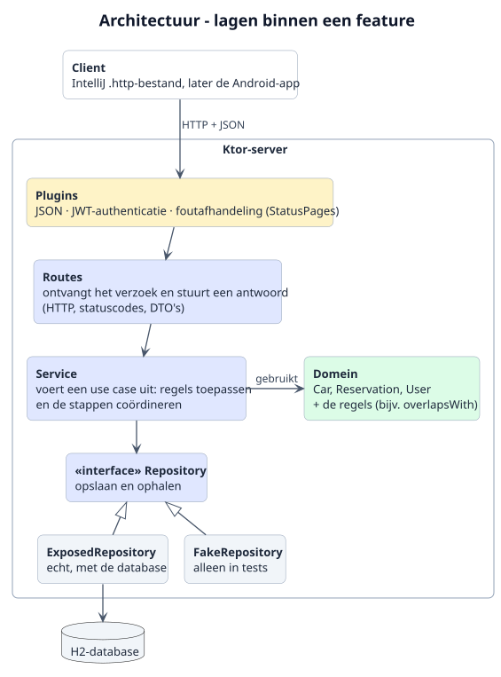

# 3. Web API

## 3.1 Architectuur



Bron: [`puml/architecture.puml`](puml/architecture.puml)

### Lagen

Elk verzoek dat bij de server binnenkomt, gaat door dezelfde lagen. Elke laag heeft één verantwoordelijkheid:

| Laag | Verantwoordelijkheid | Voorbeeld |
|---|---|---|
| **Plugins** | Algemene zaken voor alle verzoeken: JSON omzetten, controleren of de gebruiker is ingelogd (JWT) en fouten omzetten naar een nette foutmelding. | Een verzoek zonder geldig token krijgt status 401. |
| **Routes** | Alleen HTTP: het verzoek uitlezen, de service aanroepen en een antwoord met de juiste statuscode terugsturen. Hier worden DTO's omgezet naar domeinobjecten en terug. | `POST /reservations/{id}/approve` roept `ReservationService.approve()` aan. |
| **Service** | Een use case uitvoeren: de stappen coördineren en de regels toepassen. | Bij goedkeuren: de aanvraag ophalen, controleren dat de gebruiker de eigenaar is, controleren op overlap en de nieuwe status opslaan. |
| **Domein** | De klassen en regels van Rent my car (hoofdstuk 2). Het domein weet niets van HTTP of de database. | `reservation.overlapsWith(other)` |
| **Repository** | Domeinobjecten opslaan en ophalen. De service praat alleen met de *interface*; de echte versie gebruikt Exposed en de H2-database. | `ExposedReservationRepository` |

Doordat de service alleen de interface van de repository kent, kan in de tests een nep-versie (`FakeRepository`) worden meegegeven. Dan kunnen de routes en services worden getest zonder database (zie hoofdstuk 4).

### Indeling per feature

De lagen zitten niet in één grote map per laag, maar in een package per feature (`users`, `cars`, `reservations`; zie het packagediagram in hoofdstuk 2.3). Alles wat bij auto's hoort, staat dus bij elkaar. Binnen elke feature zijn de lagen wel te herkennen aan de bestandsnamen:

```
rentmycar/server/
├── Server.kt          main(): laadt de instellingen en start de server
├── Application.kt     installeert de plugins en koppelt de routes
├── Dependencies.kt    maakt alle repositories en services aan
├── users/
├── cars/
│   ├── CarRoutes.kt
│   ├── CarService.kt
│   ├── CarRepository.kt
│   └── Car.kt
├── reservations/
└── common/
```

### Onderdelen aan elkaar koppelen (dependency injection)

In `Dependencies.kt` worden alle repositories en services één keer aangemaakt en als parameter aan elkaar doorgegeven:

```kotlin
// Build all parts of the app
val carRepository = ExposedCarRepository(database)
val carService = CarService(carRepository)
```

Hiervoor wordt geen apart framework gebruikt. Het is gewone Kotlin-code die in volgorde wordt uitgevoerd, dus makkelijk te volgen. In een test wordt op dezelfde manier een `CarService` gemaakt, maar dan met een `FakeCarRepository`.

### Herkomst van de keuzes

| Keuze | Bron | Afwijking? |
|---|---|---|
| Scheiding in routes, service, domein en repository | Leeruitkomst 1 ("scheidt verantwoordelijkheden: routing, use-cases/service, domein, persistence"); les 3 en 4 ("klassieke 3-lagen: route, services en repository"); les 6 ("toepassen service layer") | Nee |
| Indeling per feature (`users`, `cars`, `reservations`) | Gastles Ktor (`nomisRev/avans-toolchain-and-ktor-2026`, *architecture*: "Keep feature code together"); voorbeeldapplicatie van de docent (`auth`, `users`, `incidents`) | Nee |
| `Server.kt`, `Application.kt` en `Dependencies.kt` | Gastles Ktor ("Bootstrap constructs; application wires"); voorbeeldapplicatie van de docent (`Dependencies.kt`) | Nee |
| Interfaces alleen voor repositories | Gastles Ktor: "Don't create an interface for every class automatically" | Nee |
| Fake repositories in tests | Les 7 (`FakeTaskRepository`); voorbeeldapplicatie van de docent (`FakeUserRepository`) | Nee |
| **Geen Koin** voor dependency injection | Gastles Ktor: "dependency injection without a framework" | **Ja.** Op Brightspace (*Handige overzichten*) wordt Koin aanbevolen. Ik volg het advies van de gastles, omdat het zonder framework eenvoudiger is en voor deze applicatie voldoende. |
| **Een service voor elke feature** | Les 6 ("toepassen service layer") | **Klein verschil.** De gastles zegt een service pas toe te voegen als er een echte use case is. Alle drie de features hebben regels (eigenaarschap, overlap, wachtwoorden), dus een service is hier steeds nodig. |
| **Domeinklassen in `server`**, alleen DTO's en enums in `core` | Voorbeeldapplicatie van de docent: DTO's en enums in de gedeelde module | **Ja.** In de demo van de docent staan ook de domeinmodellen in de gedeelde module. Ik houd de domeinklassen op de server, omdat de regels en berekeningen alleen daar worden uitgevoerd; de app krijgt de uitkomsten via de DTO's. |
| Module heet `core` in plaats van `shared` | De wizard maakte de module `core` aan; `app/shared` bestaat al voor de app | Alleen een andere naam |

## 3.2 Endpoints
_Nog in te vullen._

## 3.3 Foutafhandeling en statuscodes
_Nog in te vullen._

## 3.4 Authenticatie en autorisatie
_Nog in te vullen._

## 3.5 AI-agent
_Nog in te vullen._

## 3.6 Sequence diagrams
_Nog in te vullen._
